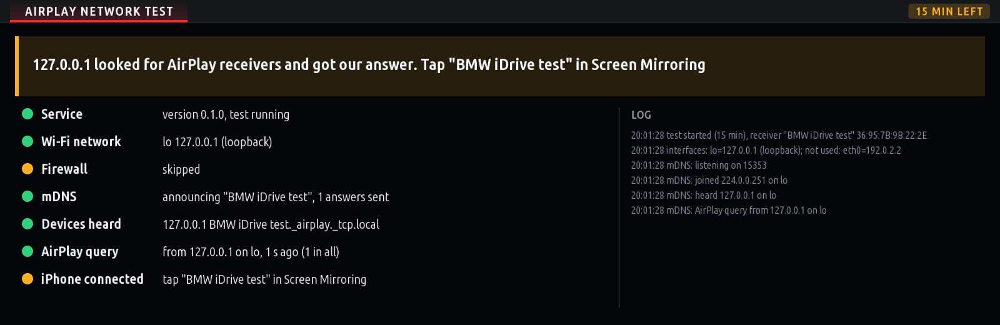
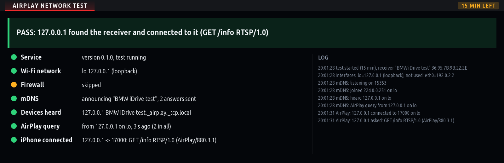

# BMW iDrive 7 Test Apps (MGU)

> [!WARNING]
> **The apps in this repository are still being designed and tested.**
> They are published here only so they can be installed straight from the Store for testing in
> the car. They may not work, may not work on your car, may behave differently from one version
> to the next, and may send commands to the car's control units. Use them at your own risk. Only
> test them while the car is parked, and don't rely on them.
>
> Apps that work well move to **[aurelmarius/bmw-apps](https://github.com/aurelmarius/bmw-apps)**.
> That is the repository to use for everyday apps.

Custom applications for BMW iDrive 7 (MGU head units), compatible with **Robert Nisipeanu's
mgu-store** and **IterioDev's App Manager**. Built with the same kit as
[aurelmarius/bmw-apps](https://github.com/aurelmarius/bmw-apps).

---

## 🧪 Apps being tested

> **Graduated:** Wheel Heating (`aurelm_wheel_heat`) works in the car and moved to [aurelmarius/bmw-apps](https://github.com/aurelmarius/bmw-apps) (1.0.6); install it from there.

### 📡 AirPlay Test (`aurelm_airplay_probe`) + AirPlay network test service (`aurelm-airplay-probe`)
*A network test for a future AirPlay receiver: can an iPhone find the head unit and connect to it?*

**Status:** first in-car test. Not a receiver: nothing is streamed.

The app and its root service announce a test receiver, **BMW iDrive test**, on the Wi-Fi networks for 15 minutes and show step by step what gets through: the network, the firewall, mDNS, the iPhone's AirPlay query and its connection. While the test runs, the service opens the firewall for its AirPlay port (tcp 7300; 7000 is the car's own CarPlay receiver's) and udp 5353 on the Wi-Fi interfaces only, and closes it again when the test ends.

1. Install **AirPlay Test**: the Store installs the **AirPlay network test service** first. **Restart the head unit once** after installing (the service listens for the app from the next start).
2. Put the iPhone and the head unit on one network, one setup per run:
   - **A. Head unit on the iPhone's hotspot:** Personal Hotspot on (Maximise Compatibility on); the head unit joins it through **mgu-uplink**.
   - **B. iPhone on the car's network:** wireless CarPlay connected.
3. In the app press **Start test**. On the iPhone: Control Center -> **Screen Mirroring**; if **BMW iDrive test** shows up, tap it.
4. **PASS** when the iPhone connected (it then says it could not connect: expected). Otherwise the first step that is not green says where it stopped. **Take a photo of the screen when you report a test.**

**The receiver ("Start receiver"), stage 2: the picture on the screen.** UxPlay's AirPlay protocol on the head unit, presenting itself as an Apple TV (iOS 27 sends the mirrored picture during CarPlay only to one), takes the iPhone's screen mirroring; the head unit's GPU decodes it and the app shows it **over the whole centre screen, only while the car is parked**. With wireless CarPlay connected: **Start receiver**, then on the iPhone Control Center → Screen Mirroring → **BMW iDrive**. Any button of the iDrive controller (or HOME) hides it (the status page is back, and the touch screen and controller are the HMI's again; a tap on the picture does nothing); **Start receiver** shows it again. **Leaving the app (HOME, another app, the CarPlay tile) ends the iPhone's mirroring**, so CarPlay can be opened at once (setting "End the iPhone's mirroring when leaving the app", on; in the car, the CarPlay tile did nothing while the iPhone still mirrored). The receiver asks the iPhone for 1920x720, the centre screen: landscape fills it, portrait has bars either side. **YouTube's own AirPlay button does not work** (it sends the video's address, not the picture, and iOS ends CarPlay for it): mirror the screen and play the video full screen instead. **No sound yet** (stage 3). If the picture does not come, the status page says where it stopped (**GPU decoder**, **On screen**): take a photo of it.
5. Removing **AirPlay Test** in the Store takes the service with it; nothing stays on the head unit ([what goes, and how](native/aurelm-airplay-probe/README.md#removal-leaves-nothing)). The service never runs at boot: only while the app is open, and 10 minutes after.



<sub>Screenshots drawn by the app on a PC, against the real service on the loopback interface.</sub>

---

## 🚀 Installation

### Via mgu-store
1. Open **Store** on your BMW central display.
2. Go to **Settings** -> **Add source**.
3. Enter:
   ```text
   aurelmarius/bmw-test-apps
   ```
4. Select **Releases** as the source type.
5. Tap **Install** next to the app you want to test.

### Via USB stick
1. Download `<id>@<version>.tgz` from [Releases](https://github.com/aurelmarius/bmw-test-apps/releases).
2. Build a USB repository:
   ```powershell
   node mgu-install.js usb-repo E:\ aurelm-airplay-probe@<version>.tgz aurelm_airplay_probe@<version>.tgz
   ```
3. Insert the USB drive into your car and install from the **USB** page of the Store.

### Via SSH
```bash
/var/opt/mgu-deploy/mgu-deploy.sh install --artifact aurelm_airplay_probe@<version>.tgz --yes
```
A service (`aurelm-airplay-probe@<version>.tgz`) installs the same way, before the app that needs it.

---

## 🛠️ Development

```bash
python3 kit/tools/build.py <id>                       # -> dist/<id>@<version>.tgz
cp dist/<id>@<version>.tgz packages/                  # a push to main with a new package publishes a release
python3 tools/pack_tools.py                           # native/<id>/ services -> packages/<id>@<version>.tgz
node tests/airplay_probe.test.js                      # the AirPlay network test service
```

**Services (tools).** A native service lives in `native/<id>/` with its `component.json` (the Store's tool
format); an app that needs one names it in its `app.json` (`"requires": {"<id>": "<version>"}`). Release
assets can carry apps only, so the release also updates the **`catalog` release**: `catalog.json` with every
app and service (absolute URLs into that release), every package and icon. The Store reads the source
through it (the source stays `aurelmarius/bmw-test-apps` on **Releases**), installs a service before the
app that requires it, and offers its removal with the app. The `catalog` release is never retired.

App ids start with `aurelm_`, as in [bmw-games](https://github.com/aurelmarius/bmw-games): ids are global on the
head unit, and the Store's publishing guide asks for a prefix of one's own. Each app has its own
`<id>.png` icon at the repository root, which the release carries for the Store.

A push to `main` that changes `packages/` publishes a release straight away (no draft), so the Store
offers it at once, and every older release becomes a pre-release (`tools/retire_older_releases.sh`):
the Store reads every published release, so an app renamed or moved would otherwise show twice. To
withdraw a release by hand, run the **Retire Releases** workflow.

**Kit**: `kit/` is the [iDrive 7 custom apps](https://github.com/cauliflowermossgrape/idrive7-apps) kit (MIT), with the packaging changes from bmw-apps.
